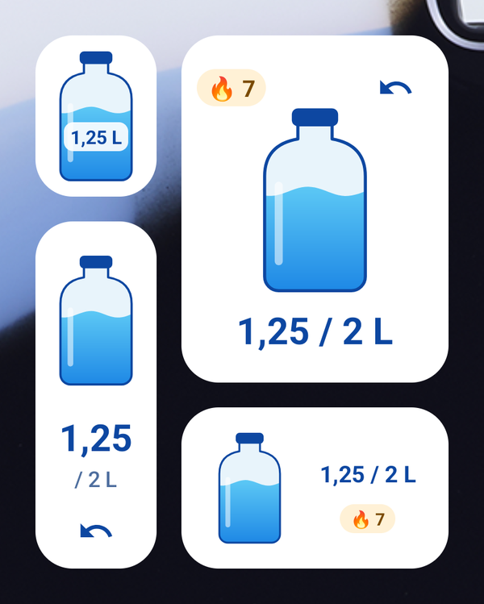
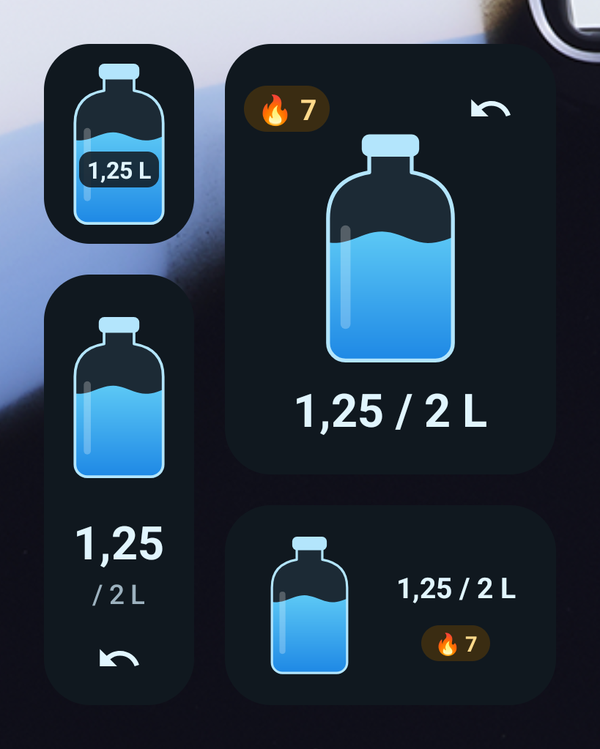
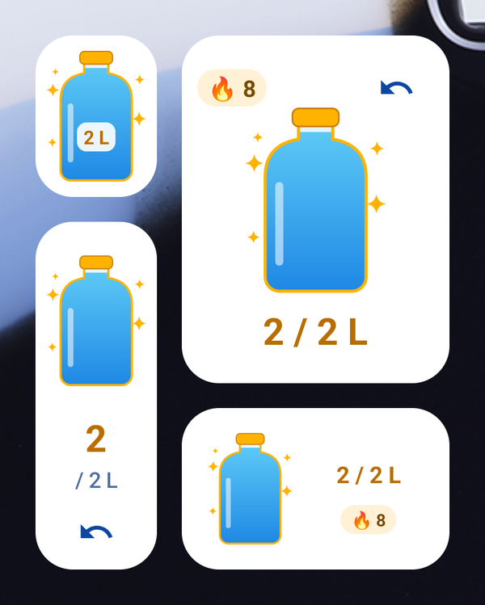
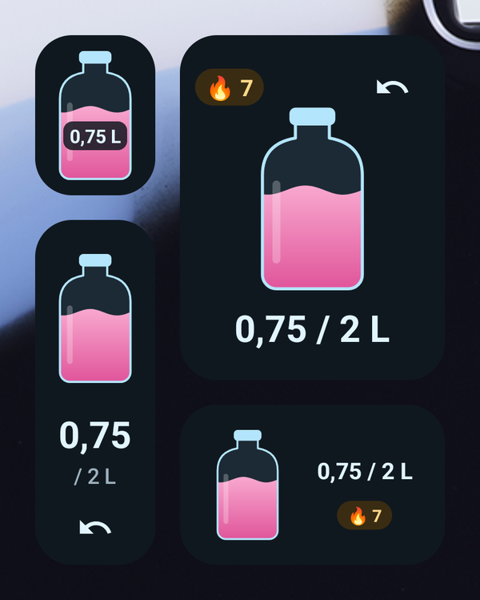
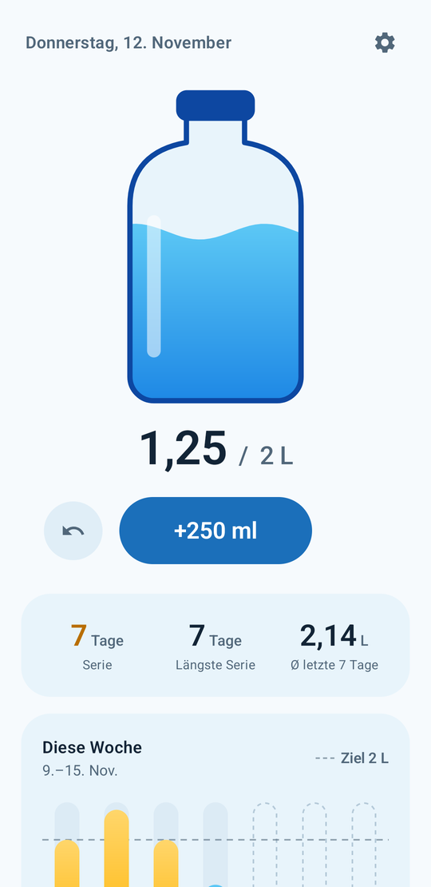
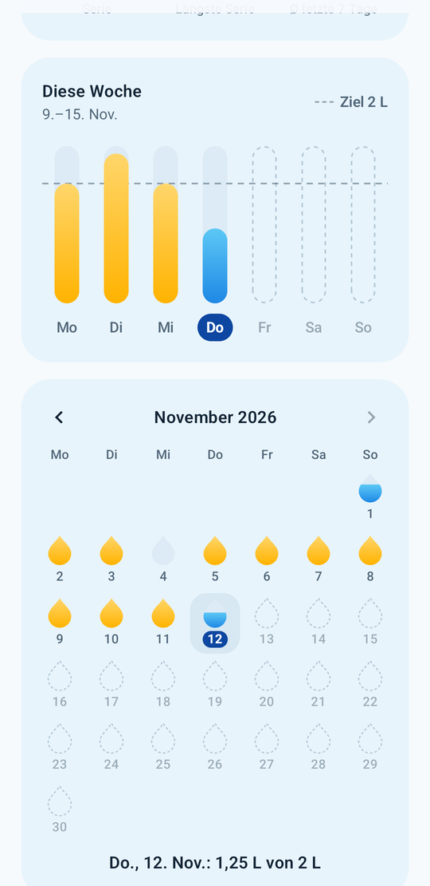

# Pegelstand

Wasser-Tracker für Android. Das Homescreen-Widget ist die Hauptsache: Ein Tap zählt ein Glas,
die Flasche füllt sich. Die App zeigt Verlauf und Einstellungen. Alles bleibt lokal auf dem Gerät.

Das Widget auf dem Startbildschirm, in vier Größen (1×1, 1×2, 2×2, 2×1):

  
  
  
  

Von links: hell, dunkel, Tagesziel erreicht, andere Wasserfarbe mit „Flasche leert sich“.

Die App:

  
  

- Widget: Tap auf die Flasche zählt die eingestellte Menge (Standard 250 ml), der Füllstand
  steigt animiert, dazwischen bewegt sich das Wasser leicht (abschaltbar); Tap daneben öffnet die
  App. Rückgängig-Pfeil, Serie in Tagen, Gold bei erreichtem Tagesziel.
- App: heutiger Stand, Serie, Wochenbalken, Monatskalender, Einstellungen für Tagesziel,
  Menge pro Tap, Wasserfarbe und ob sich die Flasche füllt oder leert.
- Erinnerungen kommen nur, wenn man hinter dem Tagesplan liegt.

Der genaue Umfang steht in [SPEC.md](SPEC.md), Testbefehle für Debug-Builds in
[docs/debug-commands.md](docs/debug-commands.md).

## Bauen

- Voraussetzungen: JDK 21, Android SDK mit Platform 36.
- SDK-Pfad bekannt machen: `ANDROID_HOME` setzen oder `local.properties` mit `sdk.dir=…` anlegen.
- Debug-APK bauen: `./gradlew :app:assembleDebug` (Windows: `gradlew.bat :app:assembleDebug`).
- Ergebnis: `app/build/outputs/apk/debug/app-debug.apk`.
- Tests: `./gradlew :app:testDebugUnitTest`.
- APK zum Weitergeben: `./gradlew :app:assembleRelease`, Ergebnis
  `app/build/outputs/apk/release/app-release.apk`. Signiert wird sie nur, wenn im Projektordner
  eine `keystore.properties` liegt (nicht im Repo) mit `storeFile`, `storePassword`, `keyAlias`
  und `keyPassword`. Ohne die Datei entsteht eine unsignierte APK, die sich nicht installieren
  lässt.

## Installieren

- Fertige APK: unter [Releases](https://github.com/kmm-codes/pegelstand/releases/latest)
  herunterladen, auf dem Handy antippen. Selbst bauen ist dafür nicht nötig.
- Gerät: Android 8.0 oder neuer.
- Per USB: USB-Debugging einschalten, dann `adb install -r app/build/outputs/apk/debug/app-debug.apk`.
- Ohne Kabel: APK aufs Handy schicken, antippen und „Unbekannte Apps installieren“ für die
  jeweilige App (Dateimanager, Messenger) erlauben.
- Updates lassen sich nur über eine frühere Version installieren, wenn sie mit demselben
  Schlüssel signiert sind. Debug-Builds tragen den Debug-Schlüssel des jeweiligen Rechners,
  die Release-APK den Schlüssel aus `keystore.properties`; ein Wechsel zwischen beiden geht nur
  über Deinstallieren, und dabei gehen die Daten verloren. Den Release-Schlüssel sichern.

## Widget hinzufügen

- Startbildschirm lange drücken, „Widgets“ wählen, „Pegelstand“ suchen und platzieren.
- Größe ändern: Widget lange drücken und an den Griffen ziehen. Es geht von 1×1 (nur die Flasche
  mit der Menge darauf) über 1×2 (schmal) bis 4×2.
- Bedienung: Tipp auf die Flasche zählt, alles andere im Widget öffnet die App, der Pfeil macht
  den letzten Tipp rückgängig.

## Lizenz

[MIT](LICENSE).
